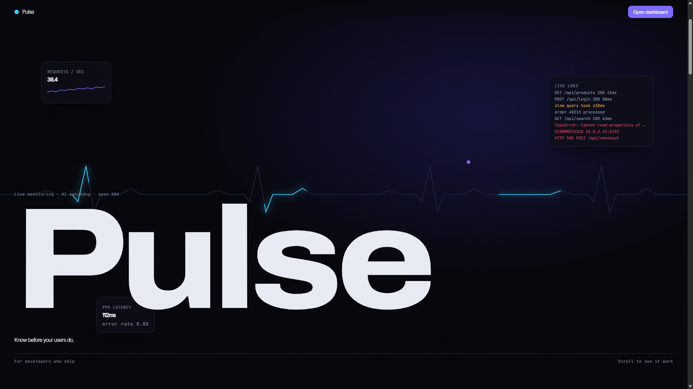
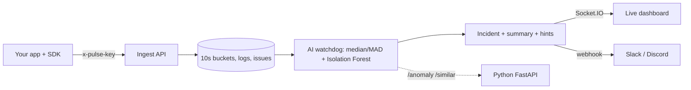

# Pulse
<p align="center">
  
</p>

<h1 align="center">Pulse</h1>

<p align="center">
  Live monitoring with an AI watchdog.
  <br />
  Real-time logs, performance metrics, anomaly detection, and incident monitoring in one dashboard.
</p>

<p align="center">
  <a href="https://pulse-eta-eight-32.vercel.app/">Live Demo</a>
  ·
  <a href="https://github.com/rahul-diw/pulse">GitHub Repository</a>
</p>

---


**Live monitoring with an AI watchdog.** Add 3 lines to any app and logs, errors and metrics stream into a live dashboard. Pulse learns what "normal" looks like, and when something breaks it opens an **incident with a plain-language explanation** (which route is failing, the top error, the deploy behind it), notifies Slack, and closes the incident itself when things recover.

| Layer | Tech |
|---|---|
| Frontend | React 19, **TypeScript**, Vite, React Router, GSAP + ScrollTrigger, Lenis, custom SVG charts, Socket.IO client |
| Backend | **Node.js**, Express, **TypeScript**, **MongoDB**, **JWT** (access + refresh, 4 roles), zod, Socket.IO, bcrypt |
| AI service | **Python**, FastAPI, scikit-learn (**Isolation Forest**, **TF-IDF**), numpy |
| SDK | zero-dependency ES module (`sdk/pulse.mjs`) with batching and an Express middleware |
| Cloud / DevOps | Docker, docker-compose, MongoDB Atlas, Render, Vercel, GitHub Actions |



## What it does
- **Ingest:** requests (method, route, status, latency), logs, custom metrics, deploy markers. API-key auth, batching, rate limit.
- **Live dashboard:** throughput, error rate, p50/p95/p99 (from histograms), top routes, deploy markers and incident bands on every chart; live log stream with filters; custom metrics explorer.
- **Issues:** errors are fingerprinted (ids, numbers, URLs normalised) and grouped; trend, samples, hints, **similar issues** (TF-IDF), regression detection when a resolved issue returns.
- **AI watchdog (every 10 seconds):** compares the latest 30s with the previous 10 minutes using robust statistics (median/MAD) for error rate, p95 latency and traffic drops, plus an Isolation Forest anomaly score from the Python service. Opens an incident, keeps **re-analysing it** as evidence arrives (title, culprit route, top errors, deploy link), escalates severity, and **auto-resolves** after a minute of normal behaviour.
- **Incident page:** AI summary, signals, suggested next steps, error-rate chart with the incident band, failing routes, top errors (linked to issue pages), timeline, error logs, **similar past incidents**.
- **Uptime monitors:** pings your URLs every minute; two failures open an incident.
- **Alert rules** with thresholds, **deploy markers**, **team roles** (owner, admin, member, viewer), **Slack/Discord webhook** on open, escalate and resolve.
- **"Simulate" button** on the demo project: outage, slow database, bad deploy, traffic spike. The synthetic traffic goes through the real ingest and watchdog.

## Monitor your own app
```js
import { Pulse } from './pulse.mjs';                       // sdk/pulse.mjs
const pulse = new Pulse({ key: 'pk_...', url: 'https://your-pulse-api', service: 'api', release: 'v1.2.0' });
app.use(pulse.middleware());     // every request: method, route, status, latency
app.use(pulse.errorHandler());   // after your routes: exceptions become error logs
pulse.log('info', 'order placed', { id: 42 }); pulse.metric('queue.depth', 12); await pulse.deploy('v1.2.0');
```
Python or any language: `POST /api/ingest` with header `x-pulse-key` (see Settings > Install in the app).

## Run it
```bash
cd ai-service && pip install -r requirements.txt && uvicorn app.main:app --port 8000     # optional: falls back to built-in models
npm install && cd backend && npm install && npm run dev                                    # seeds a demo project with live traffic
cd frontend && npm install && npm run dev                                                  # http://localhost:5173
```
Or `docker compose up --build` (with MongoDB) and open http://localhost:8080.
Demo logins: `owner@pulse.dev / Demo@123`, `viewer@pulse.dev / Viewer@123`. Create your own workspace at `/signup`.

## Tests
```bash
cd backend && npm test             # 24 tests: detection on synthetic traffic (no false alarms, outage, latency, traffic cliff, auto-resolve), ingest, RBAC, tenancy, rules, monitors, webhooks
cd ai-service && python -m pytest  # 5 tests
bash scripts/e2e.sh                # real API + Python service + SDK + Express app + Socket.IO: outage -> incident
cd frontend && npm run build:demo && npm run smoke   # drives the whole UI in jsdom, including a live outage
```

## Deploy
MongoDB Atlas (free) -> Render Blueprint (`render.yaml`; set `MONGO_URI`, `CORS_ORIGIN`, keep `SEED_DEMO=false`) -> Vercel (repo root; env `VITE_API_URL`, `VITE_WS_URL`). Run **one** API instance.

## Honest notes
- The "AI" is statistics plus a small Isolation Forest, and the incident summary is rule-based. There is no LLM, so it never invents causes: every sentence comes from measured data.
- The one-file demo runs the **same API core in the browser**; its traffic is synthetic.
- Tested here: backend (in-memory store), Python service, the whole stack together, the UI in jsdom. **Not tested here:** a live MongoDB server (same store interface, run `docker compose up` once), a real Slack webhook, a real browser's rendering and animations.
- Known limits: bucket writes are serialised per project **inside one process**, so run a single API instance (a multi-instance version needs `$inc` upserts); data is kept for 24 hours; API keys are stored in plain text (hash them before opening to the public).

## Resume bullets
- Built **Pulse**, a live monitoring platform (React + TypeScript, Node/Express, MongoDB, Python FastAPI) with an SDK, ingest API, 10-second metric buckets with latency histograms (p50/p95/p99), error fingerprinting, JWT auth and 4-role RBAC.
- Designed an **AI watchdog** combining robust statistics (median/MAD) with an **Isolation Forest** that detects error-rate, latency and traffic anomalies, opens incidents with a data-driven summary and culprit route, escalates, notifies Slack, and auto-resolves.
- Architected the API as a framework-free **shared core** that runs on the server and in the browser, so the live demo executes production logic; verified with 24 tests on synthetic traffic, 5 Python tests, an SDK-to-incident end-to-end script and a UI smoke test.
- Shipped with Docker, GitHub Actions CI, Render and Vercel deploy configs.
